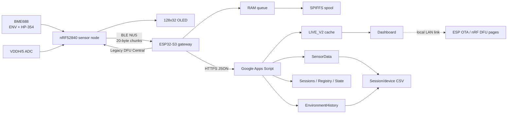
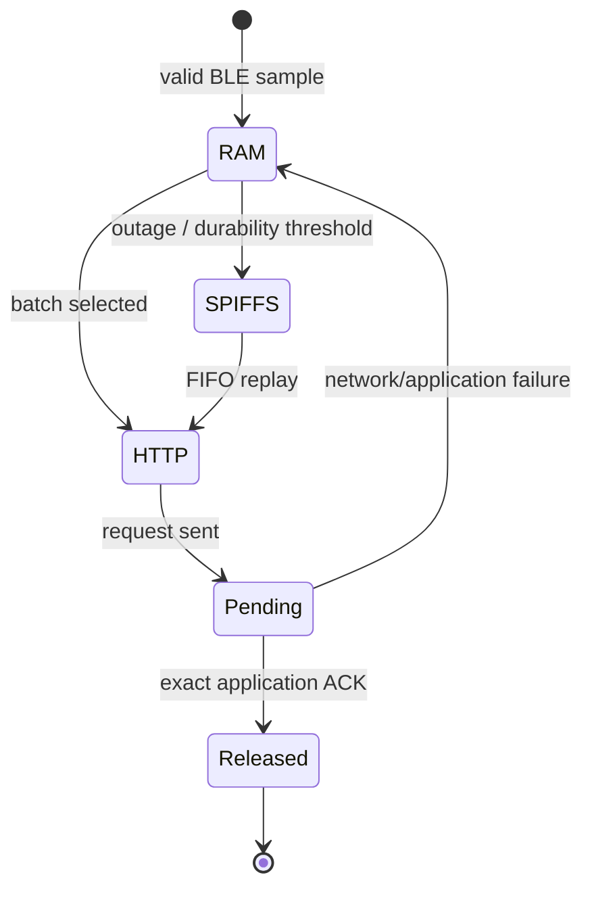

# 시스템 아키텍처와 데이터 흐름

이 문서는 현재 구현의 경계와 프로토콜을 설명한다. 운용 상태와 최신 검증 결과는 [`PROJECT_STATE.md`](../PROJECT_STATE.md), 기능별 상태는 [`FEATURES.md`](FEATURES.md)를 함께 참고한다.

## 전체 구성



클라우드 대시보드는 장치 상태와 로컬 관리 주소를 보여주지만 펌웨어 binary를 Apps Script가 중계하지 않는다. OTA/DFU 실제 upload는 브라우저와 같은 LAN의 ESP32 로컬 서버에 직접 접속한다.

## 컴포넌트와 책임

| 계층 | 책임 | 주요 파일 |
|---|---|---|
| Sensor driver | BME688 초기화, forced ENV, HP-354 parallel scan, valid-step 판정 | `firmware/nrf52840/bme688_node/bme688_node.ino`, `Scan.h`, 고정 Bosch driver |
| Sensor presentation | OLED, VDDH 측정, 잔량 추정/보정, BLE status | `bme688_node.ino`, `Battery.h` |
| BLE transport | NUS advertising, chunk/newline framing, reconnect, DFU entry | `bme688_node.ino` |
| Gateway ingest | BLE scan/pair/connect, frame parse, timestamp/UID, RAM queue | `firmware/esp32s3/gateway/gateway.ino`, `Integrity.h` |
| Durable queue | CRC record, temporary write/readback/rename, FIFO replay | `Spool.h` |
| Network | dual Wi-Fi recovery, mDNS, HTTPS POST/redirect/ACK, health heartbeat | `gateway.ino`, `WifiRecoveryPolicy.h` |
| Local UI/update | LCD/NeoPixel, authenticated ESP OTA, nRF ZIP upload and DFU relay | `GatewayUi.h`, `gateway.ino`, `NrfDfu*` files |
| Cloud ingest | schema validation, journal, dedup, ACK, device/session assignment | `cloud/apps_script/Code.gs` |
| Dashboard/export | per-device status, recording control, CSV pagination, local update links | `cloud/apps_script/Dashboard.html`, `Code.gs` |
| Analysis | complete HP-354 scan reconstruction and feature preparation | `analysis/fingerprints.py` |

## 센서 측정 상태 머신

### 환경 경로

평상시 nRF52840은 히터를 끈 BME688 forced mode에서 약 120초마다 T/H/P를 측정한다. 유효 측정은 즉시 OLED 최신값과 BLE `ENV` frame을 갱신한다. ESP32는 최신값을 health 상태에 보관하지만 모든 ENV frame마다 spool 또는 Sheets 행을 만들지는 않는다. 가스 스캔 시각에는 정규 ENV 타이머와 별개로 forced T/H/P를 새로 성공시킨 뒤 HP-354를 시작한다.

클라우드는 다음 두 시간을 분리한다.

- **Live health:** ESP32가 약 5초 heartbeat 또는 data POST에 싣는 최신 environment와 `age_ms`.
- **Environment history:** ESP32가 약 5분 간격으로 만드는 schema 4 sample.

따라서 dashboard의 최신 온습도·기압과 5분 이력은 독립적이다. gas scan/cooling 동안 새 ENV가 일시 정지되면 dashboard는 마지막 값과 실제 경과시간을 유지하고 stale을 표시한다.

### 가스 경로

현재 소스는 10분마다 HP-354 parallel scan을 시도한다. scan은 10개 heater step을 가지며 각 valid step이 독립 v3 sample이다. Bosch status에서 gas validity와 heater stability가 만족되고 T/H/P/G가 유한하며 gas resistance가 양수인 step만 전송한다.

`GASM_VALID=0` dummy conversion은 polling 중 정상 대기다. timeout, invalid real step과 누락 step을 `G=0`으로 채우지 않는다. scan 이후 60초 cooling 동안 상태를 명시하고 환경 측정을 안전하게 재개한다.

## BLE NUS wire protocol

각 logical frame은 ASCII 한 줄이며 nRF가 최대 20 bytes씩 write하고 마지막에 newline을 보낸다. ESP32는 newline까지 재조립한 뒤 parse한다. BLE packet 하나를 sample 하나로 취급하지 않는다.

### 환경 frame

```text
ENV,BID=<boot>,SEQ=<seq>,MS=<capture-ms>,T=<C>,H=<%>,P=<hPa>
```

### HP-354 step frame

```text
V=3,BID=<boot>,SEQ=<seq>,SCAN=<scan>,STEP=<0..9>,GI=<index>,MI=<index>,
MS=<capture-ms>,ST=<status>,PID=354,T=<C>,H=<%>,P=<hPa>,G=<kOhm>
```

### 상태 frame

`STAT`은 firmware/sensor/scan 상태와 배터리 확장 필드를 전달하는 진단 frame이다. `BV`는 mV, `BOK`는 battery reading validity, `USB`는 USB 전원 상태, `BP`는 nRF가 계산한 현재 percentage estimate, `BS`는 calibration state, 선택적 `BM`은 마지막 battery-only observation의 nRF uptime이다. 선택적 `BLP`는 USB 연결 전 마지막 runtime percentage이며 현재 충전율이 아니다. 구버전 sensor처럼 이 필드가 없어도 gateway는 기존 환경/가스 frame을 처리한다.

Adafruit core의 FreeRTOS tickless idle과 SoftDevice event wait를 그대로 사용하며, firmware는 System ON variable-latency low-power mode를 명시한다. ENV는 120초, gas scan은 10분이며 scan 직전 forced T/H/P를 새로 얻는다. core Wire가 TWIM event를 무기한 기다리는 경우에도 상위 FreeRTOS software timer가 120초 loop 정지를 감지해 application을 재시작한다. 이 timer는 Legacy DFU bootloader로 이어지지 않는다. System OFF는 BLE와 주기 측정을 끊고 wake 시 reset되므로 현재 상태 머신에 넣지 않는다. 상세 근거와 계측 절차는 [`NRF52840_LOW_POWER.md`](NRF52840_LOW_POWER.md)에 있다.

Boot ID와 sequence는 센서 재부팅과 valid measurement 순서를 구분한다. sequence는 성공한 측정에만 증가한다.

## Gateway ingest와 식별자

ESP32는 eFuse MAC에서 안정적인 `device_id`를 만들고, 부팅마다 별도 `gatewayBoot`을 생성한다. nRF는 `sensor_id`, boot ID와 sequence를 보낸다. 이 값들의 역할은 다르다.

- `device_id`: dashboard, session, CSV와 multi-device 분리.
- `gatewayBoot` + receive sequence: cloud ACK와 retry identity.
- `sensor_id`: BLE pairing 및 DFU 대상 확인.
- sensor boot/sequence/scan/step: 측정 출처와 scan completeness.

BLE address는 연결 정보이며 sensor identity를 대신하지 않는다. normal collection은 legacy `ANY` mode를 지원하지만 nRF DFU는 명시적으로 paired sensor가 연결되어야 한다.

수신 frame은 capture time을 보정할 수 있으면 epoch를 부여한다. session은 HTTP 도착 시간이 아니라 capture time으로 배정된다. capture time을 확정할 수 없는 sample은 `Unassigned`에 남는다.

## Queue, spool과 ACK



핵심 무결성 규칙은 다음과 같다.

1. valid application ACK 전에 sample을 제거하지 않는다.
2. retry/reboot replay는 같은 UID를 사용한다.
3. v2 88-byte record와 v3 120-byte record를 각각의 형식과 CRC로 읽는다.
4. spool은 `.tmp` write, readback/CRC 후 최종 rename한다.
5. filesystem을 자동 format하지 않고 fault를 명시한다.
6. overflow 시 미확인 데이터를 덮어쓰지 않는다.

Data batch는 최대 32 samples이고 data upload가 health heartbeat보다 우선한다. data POST가 최신 health를 함께 갱신하면 별도 heartbeat를 중복 시작하지 않는다. HTTP 작업 중에는 다음 작업을 겹쳐 시작하지 않는다.

## Wi-Fi, HTTPS와 메모리

최대 네 NVS credential slot은 기존 형식을 유지한다. last-success slot을 먼저 시도하고 연결 실패/disconnect event 뒤 다음 slot로 전환한다. 두 AP가 모두 없으면 제한된 backoff로 다시 순환하며 정상 연결을 불필요하게 끊지 않는다. mDNS `foodmonitor.local`은 편의 주소이고 실패해도 IP 접속과 cloud upload는 계속한다.

HTTPS request는 host name을 SNI/HTTP에 유지하면서 이미 해결한 IP를 secure client에 전달하는 경로를 사용한다. 이는 ESP-IDF/lwIP core-lock 문맥 문제를 피하기 위한 현재 구현이다. prototype은 `setInsecure()`를 사용하므로 공개 배포 전 CA 검증이 남은 보안 부채다.

큰 JSON은 먼저 직렬화한 뒤 exact-size PSRAM buffer로 복사하고 내부 임시 memory를 TLS handshake 전에 해제한다. PSRAM 할당이 실패하면 internal RAM fallback을 사용한다. TLS, Wi-Fi/BLE stack, RTOS 객체와 DMA 요구 객체가 모두 PSRAM을 사용할 수 있는 것은 아니다. heap 로그는 total free와 largest contiguous internal block, minimum free를 함께 보아 leak, fragmentation, 순간 부족을 구분한다. 세부 사항은 [`PSRAM_AND_TECH_DEBT.md`](PSRAM_AND_TECH_DEBT.md)에 있다.

## Cloud API와 저장 구조

Apps Script ingest API는 JSON version 3 envelope 안에서 sample schema를 구분한다.

| Schema | 의미 | 저장 |
|---|---|---|
| 2 | legacy gas sample | `SensorData` |
| 3 | HP-354 gas step | `SensorData`의 확장 열 |
| 4 | 저빈도 environment history | `EnvironmentHistory` |

`SensorData`의 기존 첫 12열과 기존 행은 보존한다. 필요한 header는 additive migration으로만 추가한다. 장치/세션 metadata는 `DeviceRegistry`, `Sessions`, ingest dedup/high-water는 `IngestState`와 cache를 사용한다. `BatteryHistory`는 health에서 확인한 실제 전압, 센서가 계산한 추정 %, USB/유효성, sensor boot/uptime과 server receive time을 장치별 최대 5분 간격으로 보존한다. 배터리 이력 실패는 sample journal/ACK를 실패시키지 않는다.

실제 data ingest는 ScriptLock 안에서 journal recovery, validation, append/dedup, state update를 수행하고 완료 후 ACK한다. 반환 status는 저장, duplicate, recording 외 sample, 시간 미확정 sample을 구분한다. 빈 heartbeat는 spreadsheet transaction과 전역 lock을 불필요하게 점유하지 않는 fast path를 사용하되 device live state와 recording/OTA policy 응답을 보존한다.

대시보드는 5초마다 per-device live state를 조회한다. battery graph는 별도 요청으로 최근 24시간, 7일 또는 전체 실제 기록을 조회하며 15분 이상 공백은 선을 끊고 임의 보간하지 않는다. lock contention으로 recording 상태를 확정할 수 없으면 추측한 상태 대신 unknown/error 상태를 표시한다. `server_seen_at`과 sensor `age_ms`를 분리해 cloud 도착과 실제 측정 나이를 혼동하지 않는다.

## Recording과 CSV

Recording은 device별 상태이며 session은 이름, start, optional stop과 ID를 가진다. sample capture time이 session의 `[start, stop)` 안에 있을 때 해당 실험에 배정된다. 종료 후 늦게 도착한 sample도 capture time이 범위에 들면 원래 session에 포함된다.

CSV는 다음 경로를 제공한다.

- 선택한 최근/현재 session CSV
- 해당 device 전체 CSV
- 최대 10,000 rows와 명시적 `offset`/`limit` pagination

한글 experiment name은 CSV 본문과 session metadata에 유지된다. HTTP download filename은 Apps Script 제한을 피하기 위해 안전한 ASCII fallback을 사용한다.

## Multi-device 구조

동일 Apps Script와 dashboard가 여러 gateway를 `device_id`로 분리한다. recording state, live cache, sessions, CSV와 update link도 device별이다. ID가 없던 과거 data는 `legacy`로 유지하며 임의 device로 이동하지 않는다.

소프트웨어는 두 가상 device의 병렬 ingest와 독립 session을 테스트한다. 현재 2호기 hardware가 없으므로 radio coexistence, 두 gateway 동시 upload와 실제 UI 운용은 현장 미검증이다.

## ESP32 Wi-Fi OTA

### Flash layout

현재 sketch-local `partitions.csv`의 핵심 layout은 다음과 같다.

| Partition | Offset | Size |
|---|---:|---:|
| NVS | `0x9000` | `0x5000` |
| otadata | `0xE000` | `0x2000` |
| app0 | `0x10000` | `0x300000` |
| SPIFFS | `0x310000` | `0xE0000` |
| coredump | `0x3F0000` | `0x10000` |
| app1 | `0x400000` | `0x300000` |

이 layout은 기존 SPIFFS 주소를 유지하면서 두 3 MiB app slot을 제공한다. Arduino IDE는 16 MB flash, sketch custom partition, OPI PSRAM, USB CDC On Boot와 Hardware CDC/JTAG, Erase All Flash Disabled 설정을 사용한다. 과거 Huge APP/No OTA dump는 역사 기록이며 현재 OTA build 설정과 혼용하지 않는다.

### Update flow

1. 인증된 local page에서 signed manifest를 upload한다.
2. target, semantic version, monotonic build, image size/SHA-256, ECDSA P-256 signature를 검증한다.
3. `OTA_PREPARE`에서 recording STOPPED, RAM/spool drain과 진행 중 HTTP 완료를 기다리고 새 heartbeat를 억제한다.
4. `OTA_ACTIVE`에서 새 measurement 유입을 제어하고 inactive app slot에 streaming write한다.
5. 실제 수신 크기/hash/write result가 모두 맞을 때 `Update.end(true)`로 image를 확정한다.
6. reboot self-check 후 rollback을 해제하고 success rainbow를 표시한다.

실패, 취소와 timeout은 normal collection을 복구하며 기존 app 선택과 spool을 보존한다. OTA와 nRF DFU는 동시에 활성화될 수 없다.

## nRF52840 Legacy DFU relay

ESP32는 Secure DFU가 아닌 Adafruit 계열 Legacy DFU 0.5 Central을 구현한다.

1. 인증된 `/nrf-dfu` upload를 임시 SPIFFS file에 streaming 저장한다.
2. size/CRC, ZIP manifest, application BIN/DAT, device type `0x0052`, SoftDevice requirement `0x00B6`를 검증한다.
3. 기존 정상 package를 유지한 채 검증된 temp file만 recoverable rename으로 `/nrf-dfu.zip`에 반영한다.
4. 사용자가 Start를 누르면 recording/data safety를 확인하고 paired sensor에 buttonless bootloader entry를 요청한다.
5. 예상된 application disconnect 후 일반 sensor scan을 중지하고 bootloader advertisement를 찾는다.
6. Legacy DFU service/control/packet characteristics를 발견하고 notification을 활성화한다.
7. MTU는 23 이상이면 허용하지만 검증된 20-byte packet과 PRN 8을 유지하며 SPIFFS에서 streaming한다.
8. validation/activation 뒤 nRF reboot, NUS reconnect와 firmware revision을 확인한다.

브라우저가 닫혀도 gateway task 상태는 유지되고 재접속해 progress/result를 조회한다. upload만으로 DFU를 자동 시작하지 않는다. DFU 중 측정 공백은 명시되며 기존 pending data는 삭제하지 않는다.

## 오류 표시와 복구

| 문제 | 동작 |
|---|---|
| BME invalid/read failure | sample 누락, 연속 실패 recovery/backoff; stale value를 새 sample로 전송하지 않음 |
| BLE disconnect | partial frame 폐기, scan/reconnect; paired target 정책 유지 |
| Wi-Fi AP 없음 | slot failover와 bounded retry; queue/spool 유지 |
| HTTPS/TLS 실패 | 같은 UID를 유지하고 retry/backoff; ACK 전 삭제 없음 |
| SPIFFS mount/CRC fault | fault를 노출하고 자동 format/overwrite 금지 |
| Cloud lock contention | dashboard가 상태를 추측하지 않고 error/unknown 표시 |
| OTA/DFU 실패 | 기존 app/data/package 보존, update state 정리 후 normal path 복구 |
| Power brownout | detector를 비활성화하지 않음; 전원/케이블 문제를 소프트웨어 retry와 구분 |

NeoPixel은 이 내부 상태를 보여주는 표시 수단이며 색상 자체가 update 허용 조건은 아니다. 실제 safety state가 OTA/DFU 진입을 결정한다.

## 분석과 AI 경계

CSV 분석은 complete HP-354 scan을 session과 sensor boot/scan ID로 재구성하고 step 0..9, duplicate/missing과 8-bit measurement index 순서를 검사한다. 이 구조는 향후 feature extraction과 session 단위 학습/평가를 준비한다.

현재 production 경로에는 학습된 spoilage model이나 inference가 없다. OLED/NeoPixel/dashboard도 음식의 안전성을 판정하지 않는다. humidity, experiment name 또는 단일 gas value를 ground truth로 사용하지 않는다.

## 검증 경계와 배포 책임

- **사용자 실기 검증 기록:** BME688 측정, BLE→gateway, SPIFFS replay, cloud ACK/Sheets/dashboard/CSV, signed ESP OTA, smartphone Legacy DFU와 ESP→nRF relay.
- **자동 검증:** protocol/parser, spool/integrity, cloud concurrency/session/CSV, OTA package/signing, DFU package/relay state, battery estimate와 gas scan completeness.
- **현재 소스에서 재검증 필요:** 최종 battery calibration 전달, PSRAM 최적화의 장시간 TLS, 최신 Apps Script deployment, 현재 binary별 OTA/DFU, 실제 2호기 동시 운용.
- **미완성:** 검증된 spoilage ML model/inference, food-safety decision, 장기 battery-life/flash-wear 시험.

Compile, host test와 package 검증을 실제 설치·radio·cloud 성공으로 보고하지 않는다. 배포 전에는 해당 commit의 source, binary hash, manifest와 운영 Apps Script version을 함께 기록한다.
